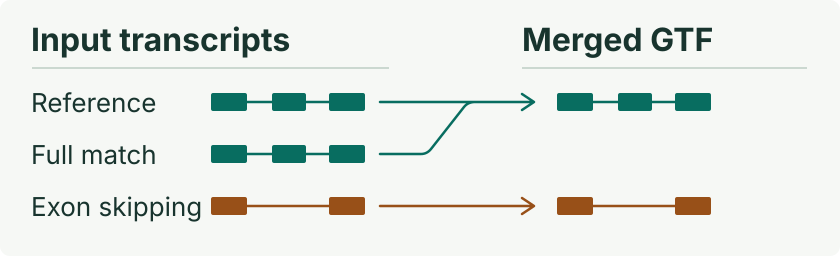

# FLTIQ

**English** · [简体中文](README.zh-CN.md)

FLTIQ (Full-Length Transcript Identification and Quantification) identifies transcript isoforms from long-read RNA sequencing data and merges them with a reference annotation into a single GTF. If you also have paired-end short reads, you can generate gene and transcript count matrices or estimate transcript abundance in transcripts per million (TPM) for each sample.

FLTIQ was used to study alternative splicing in the mouse heart after myocardial infarction and ischemia–reperfusion injury. The paper describes the study, and the sequencing data are available from GEO. [Paper](https://doi.org/10.1038/s41597-024-03998-3) · [GEO dataset GSE275835](https://www.ncbi.nlm.nih.gov/geo/query/acc.cgi?acc=GSE275835)

[Installation](#installation) · [Generate an annotation](#generate-an-annotation-from-long-reads) · [Add short-read quantification](#add-short-read-quantification) · [Reproduce the analysis from raw FASTQ](#reproduce-the-analysis-from-raw-fastq) · [Citation](#citation)

## Installation

Download and extract the FLTIQ source or open an existing checkout. From the directory containing `pyproject.toml`, install with Python 3.9 or later.

```bash
python3 -m venv .venv
source .venv/bin/activate
python -m pip install .
fltiq --version
```

If you have the wheel, you can install it in your target environment with `python -m pip install /path/to/fltiq-0.1.0-py3-none-any.whl`. Once installed, `fltiq --help` and `fltiq-merge --help` work from any directory.

**Install the analysis tools separately.** Annotation requires FLAIR, SQANTI3, AGAT and gffread. Put the command-line tools on your `PATH`. SQANTI3 can use its own environment. Pass the directory containing `sqanti3_qc.py` to `-s` and that environment’s Python executable to `--sqanti_python`.

<details>
<summary>View tools and versions by analysis step</summary>

| Analysis step | Required tools and versions |
| --- | --- |
| Generate an annotation from long reads | FLAIR 2.0.0 with minimap2, samtools and bedtools, SQANTI3 5.2.2 with its R packages for report generation, and the GTF merge tools listed below |
| Merge existing SQANTI3 results | AGAT 1.1.0 (`agat_sp_merge_annotations.pl`) and gffread 0.12.7 |
| Generate count matrices | HISAT2 2.2.1, samtools and `featureCounts` from Subread 2.0.6 |
| Estimate transcript abundance | Kallisto 0.50.1 and gffread 0.12.7 |
| Start from raw cDNA FASTQ | Pychopper 2.7.10 with HMMER and Chopper 0.8.0, plus Trimmomatic 0.39 and Java if processing raw short reads |

</details>

## Generate an annotation from long reads

Prepare quality-controlled long reads in FASTQ or FASTA format, a reference genome FASTA and a reference GTF. The genome and annotation must use the same assembly and chromosome names. This example uses cDNA. Replace the input and software paths with your own. Keep `-o results -n discovery` to use the output paths shown below.

```bash
fltiq \
  -f reads/long_cdna.fastq.gz \
  -r refs/genome.fa -a refs/annotation.gtf \
  -s /path/to/SQANTI3 --sqanti_python /path/to/sqanti-env/bin/python \
  --is_native_rna False \
  -o results -n discovery -p 8
```

The merged annotation is **`results/discovery/merge/discovery_corrected.final.gtf`**. To build a single annotation from several libraries, list their files after `-f`. For direct RNA sequencing, use `--is_native_rna True` (the default). Choose a fresh project name or output directory for each run.

FLAIR aligns reads, corrects splice sites and reconstructs transcript models. SQANTI3 compares those models with the reference annotation. The reference supplies the record for each full splice match (`full-splice_match`, FSM). Models in the other categories proceed to the merge step. The figure illustrates a transcript that skips an exon.



**Already have SQANTI3 results?** Supply the classification table and corrected GTF from the same run, together with the reference GTF used for classification.

```bash
fltiq-merge \
  -i sqanti/discovery_classification.txt \
  -g sqanti/discovery_corrected.gtf \
  -a refs/annotation.gtf -d results/merge_only
```

This writes `results/merge_only/discovery_corrected.final.gtf`. Add `--historical` to apply the historical merge rules.

## Add short-read quantification

To quantify expression in the same run, add paired-end short reads to the `fltiq` command above. For one sample, use `-1 reads/R1.fastq.gz -2 reads/R2.fastq.gz`. For multiple samples, use `--samples samples.tsv`. In this mode, list each sample once. Separate the columns with tabs. Relative read paths are resolved from the directory containing the sample sheet.

```tsv
sample	r1	r2
sample_A	reads/A_R1.fastq.gz	reads/A_R2.fastq.gz
sample_B	reads/B_R1.fastq.gz	reads/B_R2.fastq.gz
```

| Desired output | Options to add alongside the short reads |
| --- | --- |
| Gene and transcript count matrices | `-i refs/hisat2/genome` (featureCounts is the default) |
| Transcript TPM and estimated fragment counts per sample | `--quant_method kallisto` |
| Both count matrices and TPM | `--quant_method both -i refs/hisat2/genome` |

`-i` takes the HISAT2 **index prefix** for your reference genome. featureCounts assigns reads to exons and groups the counts by gene or transcript. The gene matrix counts individual reads, and the transcript matrix counts paired-end fragments. Kallisto runs 100 bootstrap replicates by default. Use `--bootstraps` to change this number.

## Find your results

Paths are relative to `<output_directory>/<project_name>/`, for example `results/discovery/`.

| Result | File |
| --- | --- |
| Merged annotation | `merge/<project>_corrected.final.gtf` |
| SQANTI3 classification for each transcript | `sqanti/<project>_classification.txt` |
| FLAIR transcript models and SQANTI3-corrected models | `flair/<project>.isoforms.gtf` and `sqanti/<project>_corrected.gtf` |
| Raw gene and transcript counts across samples | `counts/geneCounts.tsv` and `counts/transcriptCounts.tsv`, each with a `.summary` of assigned and unassigned counts |
| Transcript abundance per sample | `kallisto/samples/<sample>/abundance.tsv`, with estimated fragment counts in `est_counts` and transcripts per million in `tpm` |

## Reproduce the analysis from raw FASTQ

Use `--historical-raw` with basecalled Nanopore **cDNA** FASTQ files separated by library. The following command generates an annotation. SQANTI3 uses the CAGE peak BED and the poly(A) motif list to assess transcript ends.

```bash
fltiq --historical-raw \
  -f reads/library_A.fastq.gz reads/library_B.fastq.gz \
  -r refs/genome.fa -a refs/annotation.gtf \
  -s /path/to/SQANTI3 --sqanti_python /path/to/sqanti-env/bin/python \
  --cage-peaks refs/cage.bed --polya-motifs refs/polya_motifs.txt \
  -o results -n reproduction -p 8
```

Pychopper processes each library separately with the PCS109 kit setting. Chopper filters its main output at a minimum mean quality of 7 and a minimum length of 500 nt. FLTIQ then pools the reads in the library order given to `-f`. If a library spans multiple FASTQ files, use `--raw-library part1.fq.gz part2.fq.gz` and supply one `--raw-library` per library. This mode applies the historical FLAIR alignment settings.

**To reproduce both short-read quantification methods**, prepare `lanes.tsv` with the same three columns as `samples.tsv`. Give each sequencing batch its own row and list batches for each sample in their original order.

<details>
<summary>Show the complete command for a merged annotation, count matrices and TPM from raw FASTQ</summary>

```bash
fltiq --historical-raw \
  -f reads/library_A.fastq.gz reads/library_B.fastq.gz \
  -r refs/genome.fa -a refs/annotation.gtf \
  -s /path/to/SQANTI3 --sqanti_python /path/to/sqanti-env/bin/python \
  --cage-peaks refs/cage.bed --polya-motifs refs/polya_motifs.txt \
  --samples lanes.tsv --adapters refs/TruSeq3-PE.fa \
  --quant_method both -i refs/hisat2/genome \
  --gene-featurecounts /path/to/subread-2.0.6/bin/featureCounts \
  --transcript-featurecounts /path/to/subread-2.0.1/bin/featureCounts \
  --transcript-count-gtf refs/transcript_count.gtf \
  --reference-transcripts refs/transcripts.fa \
  -o results -n reproduction_quant -p 8
```

</details>

Trimmomatic cleans each batch of paired-end reads separately. HISAT2 and featureCounts use all batches for each sample. Kallisto uses the cleaned pairs from the first batch of each sample. Its index combines the corrected non-FSM transcript sequences with the supplied reference transcript FASTA.

When comparing counts, check the annotation and Subread version. This workflow’s historical mode uses the merged GTF and Subread **2.0.6** for gene counts. It uses a separately supplied GTF and Subread **2.0.1** for transcript counts. The paper reports Subread **2.0.1** for gene counts. [Published methods](https://doi.org/10.1038/s41597-024-03998-3)

To compare directly with a previous run, use the same reference files and indices. Pychopper samples reads to select a cutoff by default. To reuse recorded cutoffs, pass each library’s `Cutoff(q)` from `statistics.tsv` to `--pychopper-cutoffs` in library order. If parallel processing changed the order of reads, `--long-read-order` accepts an ordered list of all filtered read IDs, one per line.

## Citation

If you use FLTIQ in your research, please cite the following paper.

Xia B, Shen J, Zhang H, Chen S, Zhang X, Song M, Wang J. The alternative splicing landscape of infarcted mouse heart identifies isoform level therapeutic targets. *Scientific Data* **11**, 1154 (2024). [doi:10.1038/s41597-024-03998-3](https://doi.org/10.1038/s41597-024-03998-3)
