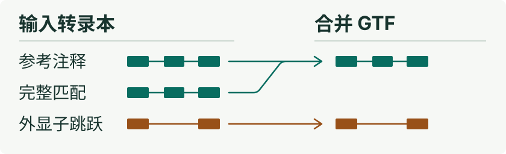

# FLTIQ

[English](README.md) · **简体中文**

FLTIQ（Full-Length Transcript Identification and Quantification）用长读长 RNA 测序数据鉴定转录本，并将其与已有的参考注释合并为一份 GTF。如果还有配对短读长 RNA-seq 数据，可以进一步生成基因和转录本的计数矩阵，或估计每个样本的转录本丰度（TPM）。

本软件用于小鼠心肌梗死与缺血再灌注后的心脏转录本研究。论文及其公开测序数据可分别在期刊和 GEO 查阅。[论文](https://doi.org/10.1038/s41597-024-03998-3) · [GEO 数据集 GSE275835](https://www.ncbi.nlm.nih.gov/geo/query/acc.cgi?acc=GSE275835)

[安装](#安装) · [从长读长生成注释](#从长读长生成注释) · [加入短读长定量](#加入短读长定量) · [从原始-fastq-复现分析](#从原始-fastq-复现分析) · [引用](#引用)

## 安装

下载并解压 FLTIQ 源码，或进入已有的源码目录。在含 `pyproject.toml` 的目录中，用 Python 3.9 或更高版本安装：

```bash
python3 -m venv .venv
source .venv/bin/activate
python -m pip install .
fltiq --version
```

如果已取得 wheel，也可以在目标环境中运行 `python -m pip install /path/to/fltiq-0.1.0-py3-none-any.whl`。安装后，`fltiq --help` 和 `fltiq-merge --help` 可从任意目录调用。

**分析工具需单独安装。** 生成注释需要 FLAIR、SQANTI3、AGAT 和 gffread。请将相应的命令行工具加入 `PATH`。SQANTI3 可使用独立环境，`-s` 指向含 `sqanti3_qc.py` 的目录，`--sqanti_python` 指向该环境的 Python。

<details>
<summary>按分析步骤查看工具和版本</summary>

| 要运行的步骤 | 所需工具及版本 |
| --- | --- |
| 从长读长生成注释 | FLAIR 2.0.0（含 minimap2、samtools、bedtools），SQANTI3 5.2.2 及其报告所需的 R 包，再加上下行的 GTF 合并工具 |
| 合并已有的 SQANTI3 结果 | AGAT 1.1.0（`agat_sp_merge_annotations.pl`）、gffread 0.12.7 |
| 生成计数矩阵 | HISAT2 2.2.1、samtools、Subread 2.0.6 的 `featureCounts` |
| 估计转录本丰度 | Kallisto 0.50.1、gffread 0.12.7 |
| 从原始 cDNA FASTQ 开始 | Pychopper 2.7.10（含 HMMER）、Chopper 0.8.0，以及处理原始短读长时使用的 Trimmomatic 0.39 和 Java |

</details>

## 从长读长生成注释

准备已质控的长读长 FASTQ 或 FASTA、参考基因组 FASTA 和同一组装的参考 GTF。基因组和 GTF 应使用一致的染色体名称。下面以 cDNA 为例，请将输入和软件路径替换为实际位置，保留 `-o` 和 `-n` 即可得到相同结构的输出目录。

```bash
fltiq \
  -f reads/long_cdna.fastq.gz \
  -r refs/genome.fa -a refs/annotation.gtf \
  -s /path/to/SQANTI3 --sqanti_python /path/to/sqanti-env/bin/python \
  --is_native_rna False \
  -o results -n discovery -p 8
```

运行结束后，打开 **`results/discovery/merge/discovery_corrected.final.gtf`** 查看合并注释。`-f` 后可按顺序列出多个文库，共同生成一份注释。直接 RNA 测序使用 `--is_native_rna True`（默认）。每次运行使用新的项目名或输出目录。

FLAIR 比对长读长、校正剪接位点并重建转录本。SQANTI3 将这些转录本与参考注释比较。已有完整剪接匹配（`full-splice_match`，FSM）的结构由参考注释保留，其余分类进入合并步骤。下图以外显子跳跃为例。



**已有 SQANTI3 结果？** 可直接提供同一次运行产生的分类表和校正 GTF，以及分类时使用的参考 GTF：

```bash
fltiq-merge \
  -i sqanti/discovery_classification.txt \
  -g sqanti/discovery_corrected.gtf \
  -a refs/annotation.gtf -d results/merge_only
```

此例输出 `results/merge_only/discovery_corrected.final.gtf`。复现历史合并规则时，追加 `--historical`。

## 加入短读长定量

要同时得到转录本结构和表达量，可在上面的 `fltiq` 长读长命令中加入配对短读长输入。单个样本用 `-1 reads/R1.fastq.gz -2 reads/R2.fastq.gz`。多个样本用 `--samples samples.tsv`，普通模式下每个样本占一行。文件以制表符分隔，读段文件的相对路径从样本表所在目录解析。

```tsv
sample	r1	r2
sample_A	reads/A_R1.fastq.gz	reads/A_R2.fastq.gz
sample_B	reads/B_R1.fastq.gz	reads/B_R2.fastq.gz
```

| 需要的结果 | 在短读长输入参数后追加 |
| --- | --- |
| 基因和转录本计数矩阵 | `-i refs/hisat2/genome`（默认使用 featureCounts） |
| 每个样本的转录本 TPM 和估计片段数 | `--quant_method kallisto` |
| 计数矩阵和 TPM | `--quant_method both -i refs/hisat2/genome` |

`-i` 是与参考基因组匹配的 HISAT2 **索引前缀**。featureCounts 按外显子计数，基因矩阵按 read 计，转录本矩阵按配对片段计。Kallisto 默认进行 100 次 bootstrap，可用 `--bootstraps` 调整。

## 查看结果

以下路径相对于 `<输出目录>/<项目名>/`，例如 `results/discovery/`。

| 想查看的内容 | 文件 |
| --- | --- |
| 合并后的参考注释 | `merge/<项目名>_corrected.final.gtf` |
| 每个转录本的 SQANTI3 分类 | `sqanti/<项目名>_classification.txt` |
| FLAIR 重建的结构与 SQANTI3 校正后的结构 | `flair/<项目名>.isoforms.gtf`、`sqanti/<项目名>_corrected.gtf` |
| 各样本的基因与转录本原始计数 | `counts/geneCounts.tsv`、`counts/transcriptCounts.tsv`，各自的 `.summary` 列出已分配和未分配的计数 |
| 各样本的转录本丰度 | `kallisto/samples/<样本名>/abundance.tsv`，`est_counts` 为估计片段数，`tpm` 为每百万转录本数 |

## 从原始 FASTQ 复现分析

`--historical-raw` 从已完成 basecalling 并按文库拆分的 Nanopore **cDNA** FASTQ 开始。只需生成注释时，可使用下列命令。CAGE 峰 BED 和 poly(A) motif 列表用于 SQANTI3 评估转录本两端。

```bash
fltiq --historical-raw \
  -f reads/library_A.fastq.gz reads/library_B.fastq.gz \
  -r refs/genome.fa -a refs/annotation.gtf \
  -s /path/to/SQANTI3 --sqanti_python /path/to/sqanti-env/bin/python \
  --cage-peaks refs/cage.bed --polya-motifs refs/polya_motifs.txt \
  -o results -n reproduction -p 8
```

每个文库单独运行 Pychopper（PCS109），主输出经 Chopper 过滤（最低平均质量 7、最短 500 nt），再按 `-f` 给定的文库顺序合并。一个文库有多个 FASTQ 分片时，改用 `--raw-library part1.fq.gz part2.fq.gz`，每个文库指定一次。此模式会为 FLAIR 比对选择历史参数。

**同时复现两种短读长定量**时，准备 `lanes.tsv`，使用与上方 `samples.tsv` 相同的三列。同一样本的不同测序批次各占一行，按原始批次顺序排列。

<details>
<summary>查看从原始 FASTQ 生成合并注释、计数矩阵和 TPM 的完整命令</summary>

```bash
fltiq --historical-raw \
  -f reads/library_A.fastq.gz reads/library_B.fastq.gz \
  -r refs/genome.fa -a refs/annotation.gtf \
  -s /path/to/SQANTI3 --sqanti_python /path/to/sqanti-env/bin/python \
  --cage-peaks refs/cage.bed --polya-motifs refs/polya_motifs.txt \
  --samples lanes.tsv --adapters refs/TruSeq3-PE.fa \
  --quant_method both -i refs/hisat2/genome \
  --gene-featurecounts /path/to/subread-2.0.6/bin/featureCounts \
  --transcript-featurecounts /path/to/subread-2.0.1/bin/featureCounts \
  --transcript-count-gtf refs/transcript_count.gtf \
  --reference-transcripts refs/transcripts.fa \
  -o results -n reproduction_quant -p 8
```

</details>

Trimmomatic 分批清洗配对短读长。HISAT2 和 featureCounts 使用每个样本的全部批次。Kallisto 使用首批清洗后的配对读段，以非 FSM 校正转录本序列和给定的参考转录本 FASTA 建索引。

比较计数时请留意参考文件和软件版本。本仓库的历史模式用本次合并的 GTF 和 Subread **2.0.6** 做基因计数，用单独提供的转录本计数 GTF 和 **2.0.1** 做转录本计数。论文方法段报告的基因计数版本为 **2.0.1**。[论文方法](https://doi.org/10.1038/s41597-024-03998-3)

如需与一次既有运行逐项对照，应使用当时版本的参考文件及索引。Pychopper 默认自动抽样确定阈值，可用 `--pychopper-cutoffs` 按文库顺序提供各自 `statistics.tsv` 中记录的 `Cutoff(q)`。若还需恢复并行处理前后可能变化的读段顺序，可用 `--long-read-order` 提供过滤后全部读段的有序 ID，每行一个。

## 引用

使用 FLTIQ 开展研究时，请引用：

Xia B, Shen J, Zhang H, Chen S, Zhang X, Song M, Wang J. The alternative splicing landscape of infarcted mouse heart identifies isoform level therapeutic targets. *Scientific Data* **11**, 1154 (2024). [doi:10.1038/s41597-024-03998-3](https://doi.org/10.1038/s41597-024-03998-3)
